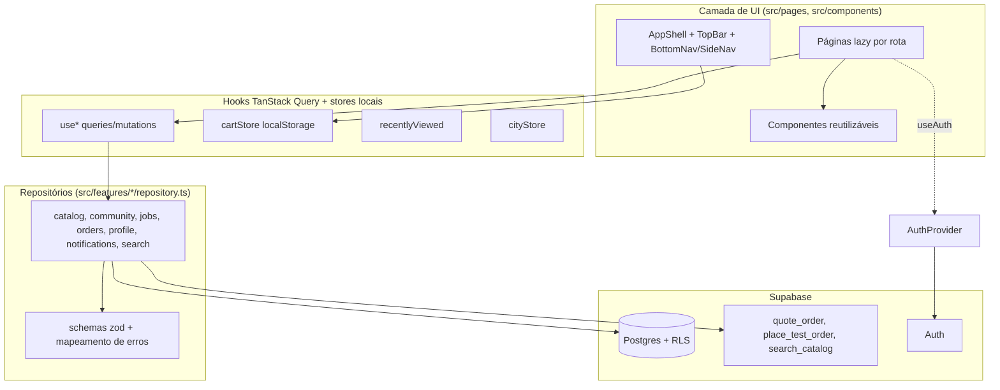
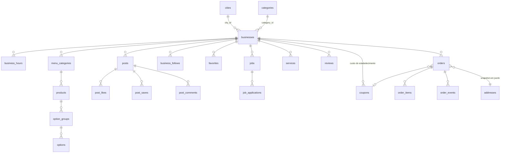

# Documento de Design: Experiência do Cliente

## Overview

Este documento descreve como a camada cliente da plataforma regional será construída para cumprir os 20 requisitos de `requirements.md`. O resultado substitui `src/features/preview/VisualPreview.tsx` (vitrine estática de ~50 kB + 54 kB de CSS) por telas reais, lidas e gravadas no Supabase por meio de repositórios, hooks TanStack Query e funções SQL `security definer`.

### Estado atual (lido antes do design)

- `src/App.tsx`: `<Routes>` com rotas de autenticação dentro de `AuthShell` e `/*` apontando para `VisualPreview`. Tudo é importado de forma estática (um único bundle; `dist/assets/index-*.js` tem hoje 614 368 bytes, o requisito cita 546 kB; vale o menor valor como teto).
- `src/main.tsx`: `QueryClientProvider` (`staleTime 30 s`, `retry 1`) > `BrowserRouter` > `AuthProvider` > `App`. Este roteador declarativo é mantido (não migra para `createBrowserRouter`), por isso restauração de rolagem e `Suspense` são feitos por hooks próprios (ver Navegação).
- `src/components/ui.tsx`: `Button`, `Field`, `Card`, `Notice` (tokens Tailwind `brand`, `ink`, `surface`, `danger`, `success`). Serão mantidos e estendidos, sem quebrar `AuthPages`/`AccountPage`.
- `src/styles/tokens.css`: `:root` com `--brand-primary #206345`, `--brand-accent #327954`, `--surface`, `--surface-muted #f8f7f2`, `--text`, `--success`, `--danger`, `--radius`, movimento, fonte. Mapeados por `@theme inline`.
- `src/features/auth`: `AuthProvider` (única fonte de sessão e papéis), `RequireAuth` (passa `state.from = pathname`), `safeRedirect` em `AuthPages` (aceita só caminhos internos, fallback `/conta`), testes com cliente Supabase simulado por `vi.mock('../../lib/supabase.ts')` e `vi.hoisted`.
- `src/features/pricing/pricing.ts`: `calculateOrder`, `DEFAULT_PRICING_CONFIG`, centavos inteiros, comissão `Math.round` (half-up para positivos).
- `src/features/permissions/permissions.ts`: matriz RBAC só de UX.
- `src/lib/supabase.ts`: cliente com chave anon e `isSupabaseConfigured`.
- `0001_foundation.sql`: `profiles` (com `preferred_city_id` sem FK), `user_roles`, `businesses` (id, name, slug, owner_id, status), `business_members`, RBAC, `audit_logs`, funções `has_role`, `is_business_member`, `has_business_permission`; `revoke all` explícito nas tabelas e `grant select on businesses to anon`.
- `supabase/tests/rls_foundation.sql` (helpers `tst.login/anon/su/ok/denied/count/affected`, tudo em `begin; ... rollback;`) e `local_auth_stub.sql` (schema `auth` mínimo, papéis `anon`/`authenticated`). Os testes de fundação já rodaram em PostgreSQL descartável (embedded-postgres, conforme `PROGRESSO.md`); existem também instalações locais do PostgreSQL 15 e 17 em `C:\Program Files\PostgreSQL`, sem `psql` no PATH.
- Steering: regras comerciais aprovadas (`business-rules.md`), segurança (RLS em tudo, nada de `USING (true)` em tabela privada, só chave anon no frontend), design system, fluxo de desenvolvimento (verificação local, sem deploy).

### Decisões de design

| ID | Decisão | Motivo |
|----|---------|--------|
| D1 | `BrowserRouter` e `<Routes>` declarativos mantidos; páginas carregadas com `React.lazy` + `Suspense` por rota. | Preserva `main.tsx` e os 45 testes existentes com `MemoryRouter`; cumpre 19.2. |
| D2 | Estrutura de navegação decidida por um hook `useBreakpoint()` (matchMedia, `useSyncExternalStore`), não só por CSS. | Renderiza apenas a navegação do layout atual (sem landmarks duplicados) e é testável em jsdom. Breakpoints coincidem com Tailwind `md` (768) e `lg` (1024). |
| D3 | Cabeçalho `position: sticky` com `top` negativo igual à diferença entre altura expandida e compacta. | A altura do elemento no fluxo nunca muda, então não há layout shift (16.1). O JS só alterna `data-compact` para animar `opacity`/`transform` da linha superior. |
| D4 | Todo acesso ao Supabase em `src/features/<modulo>/repository.ts`; componentes só usam hooks. Regra ESLint `no-restricted-imports` reforça. | 15.1; repositórios são o ponto único de mock nos testes. |
| D5 | Dados pessoais usam chaves de consulta com prefixo `['me', userId, ...]`. Ao sair ou trocar de usuário, `queryClient.removeQueries({ queryKey: ['me'] })`. A Sacola (localStorage) não é tocada. | 2.6 sem alterar `AuthProvider` (15.7). |
| D6 | A Sacola guarda só identificadores, quantidades e observações (`cart:v1` validado por zod). Preços vêm sempre do Cardápio (estimativa) e do `quote_order` (checkout). | 7.4, 7.7, 8.20. |
| D7 | Proteção de `owner_id`: a migration 0002 troca o `grant select` de tabela em `businesses` por `grant select (colunas públicas)` para `anon` e `authenticated`. | Na 0001 o `owner_id` de lojas ativas fica legível por qualquer visitante. Não altera a 0001 (14.1). Ver Riscos. |
| D8 | Comissão calculada sobre o subtotal bruto (antes do cupom). O cupom é custo do estabelecimento: reduz o `merchant_net` e o total do cliente, nunca a receita da plataforma. | 8.16 e `business-rules.md` ("a plataforma nunca financia cupons"); coerente com `PROGRESSO.md` (comissão sobre subtotal de produtos). Registrar em `ARQUITETURA.md`. |
| D9 | Busca, listagens e pedido passam por funções SQL com parâmetros. Filtros simples usam o query builder do PostgREST (sem interpolação de texto). | 4.8, 8.3. |
| D10 | Ordenação "proximidade" usa a coluna `distance_from_center_km` (distância ao centro da cidade selecionada), não geolocalização. | Só há uma cidade na fase; geolocalização fica para a spec de multicidades. |
| D11 | Rolagem animada por `requestAnimationFrame` (300 ms) na barra de categorias, não `scrollIntoView({behavior:'smooth'})`. | A duração do scroll nativo não é controlável; 6.4 exige no máximo 350 ms. |
| D12 | Propriedades de correção do frontend usam `fast-check` (devDependency com versão exata a ser confirmada no registry na implementação). Propriedades de banco usam laços de `generate_series`/`random()` com semente fixa nos testes SQL. | Não há biblioteca de PBT instalada hoje (`node_modules/fast-check` ausente). |

## Architecture

### Camadas



### Estrutura de pastas (novas e alteradas)

```
src/
  App.tsx                      # só monta rotas (AuthShell + AppShell), sem páginas estáticas
  app/
    routes.tsx                 # tabela de rotas (path, lazy page, access)
    lazy.ts                    # lazyNamed(), prefetch por hover/foco
    RouteBoundary.tsx          # ErrorBoundary + Suspense + skeleton de rota
    SessionCacheGuard.tsx      # limpa ['me'] ao sair/trocar usuário
    useScrollRestoration.ts
  components/
    ui.tsx                     # Button, Field, Card, Notice (mantidos) + variantes
    shell/ AppShell, TopBar, BottomNav, SideNav, CartFab, LocationPicker, SmartSearch
    cards/ BusinessCard, ProductCard, PostCard/*, JobCard, ServiceCard, OrderCard
    feedback/ Skeleton*, EmptyState, ErrorState, Toast, LoginPrompt
    overlays/ Dialog, Sheet, ProductModal, CartSheet
    nav/ Tabs, StickyCategoryBar, CategoryRail, FilterBar, Section
  features/
    catalog/ cart/ community/ jobs/ orders/ profile/ notifications/ search/ location/ recent/
    (cada módulo: repository.ts, schemas.ts, hooks.ts, keys.ts, *.test.ts[x])
    auth/ pricing/ permissions/   # existentes; só RequireAuth recebe ajuste
  lib/
    supabase.ts  money.ts  errors.ts  time.ts  url-state.ts  storage.ts  color.ts  a11y.ts
  pages/                        # HomePage, ExplorePage, RestaurantsPage, RestaurantPage, ...
  test/ fakeSupabase.ts         # cliente simulado reutilizável (padrão de auth-flows.test.tsx)
supabase/
  migrations/ 0002..0006
  seed/ demo_itau_de_minas.sql
  tests/ rls_experiencia.sql, supabase_default_privileges.sql (novo), existentes mantidos
scripts/ check-bundle.mjs, test-sql.mjs
```

`features/preview/*` é removido ao final da migração das telas (15.6).

### AppShell adaptativo (Requisitos 1, 16, 18.8, 19.1)

`AppShell` envolve todas as rotas de uso (menos autenticação) e escolhe a composição por `useBreakpoint()`:

| Layout | Largura | Estrutura |
|--------|---------|-----------|
| Mobile | < 768 | `TopBar` (localização, busca, sino, avatar, sacola com contador) + `<main>` + `BottomNav` fixa (5 destinos) + `CartFab` acima da barra quando há itens |
| Tablet | 768–1023 | `TopBar` + `SideNav` em modo trilho (ícones, 72 px) que expande como gaveta sobreposta (`transform`, sem reflow do conteúdo); `FilterBar` sticky nas listagens |
| Desktop | ≥ 1024 | `TopBar` (logo, localização, busca, notificações, perfil, sacola) + `SideNav` expandida (240 px) + conteúdo em `max-w-[1280px]` centralizado |

Pontos de implementação:

- **Fonte única dos destinos**: `NAV_DESTINATIONS` (`inicio`, `explorar`, `comunidade`, `pedidos`, `perfil`) com ícone Lucide, rótulo e lista de prefixos de rota. `resolveActiveDestination(pathname)` devolve o id ativo (Explorar cobre `/explorar`, `/restaurantes*`, `/lojas*`, `/servicos*`, `/vagas*`, `/busca`; Perfil cobre `/perfil*`, `/conta`, `/notificacoes`). O item ativo recebe `aria-current="page"` e indicador visual não dependente só de cor (barra/realce + rótulo em negrito, 18.7).
- **Cabeçalho que compacta**: `useCompactHeader()` observa `scrollY` por listener passivo + `requestAnimationFrame`. Regra pura `nextCompactState(prev, y)`: compacta quando `y > 48`, expande quando `y <= 8` (histerese contra oscilação; entre 8 e 48 mantém o estado anterior). Altura reservada por tokens `--header-h-expanded` e `--header-h-compact`; `top: calc((var(--header-h-expanded) - var(--header-h-compact)) * -1)`.
- **Safe areas**: `BottomNav` usa `padding-bottom: env(safe-area-inset-bottom)`; `CartFab` posiciona-se em `bottom: calc(var(--bottom-nav-h) + env(safe-area-inset-bottom) + 0.75rem)`. `<main>` reserva `padding-bottom` equivalente. O `padding-bottom: env(safe-area-inset-bottom)` já existente em `body` é removido do `body` para não duplicar.
- **Sem rolagem horizontal a 320 px**: contêineres usam `min-w-0`, grades com `minmax(0, 1fr)`, faixas horizontais (CategoryRail) com `overflow-x: auto` dentro de um contêiner com `max-w-full`.
- **Landmarks**: `header` (TopBar), `nav` (BottomNav/SideNav, `aria-label` distinto), `main#conteudo` com link "Pular para o conteúdo".
- **Restauração de rolagem**: `useScrollRestoration()` define `history.scrollRestoration = 'manual'`, grava o `scrollY` por `location.key` em `sessionStorage` e, em navegação POP, restaura depois que a listagem sinaliza `ready` (tenta por até 1 s enquanto a altura do documento for insuficiente). Como `useInfiniteQuery` mantém as páginas em cache (`gcTime` 5 min), a restauração reencontra o conteúdo. Filtros, ordenação, busca e cidade restauram porque vivem na URL e no `cityStore`.

### Mapa de rotas

React Router 7 (`react-router-dom` 7.18.5), declarativo. Tabela em `app/routes.tsx`:

| Caminho | Página (chunk) | Acesso | Requisitos |
|---------|----------------|--------|------------|
| `/` | `HomePage` | público | 3 |
| `/explorar` | `ExplorePage` | público | 5.1 |
| `/restaurantes` | `RestaurantsPage` | público | 5 |
| `/restaurantes/:slug` | `RestaurantPage` | público | 6 |
| `/lojas` | `StoresPage` | público | 5.7 |
| `/lojas/:slug` | `StorePage` (vitrine, posts, vagas; sem checkout) | público | 5.7 |
| `/servicos` | `ServicesPage` | público | 5.8 |
| `/vagas`, `/vagas/:id` | `JobsPage`, `JobPage` | público | 11 |
| `/comunidade`, `/comunidade/:postId` | `CommunityPage`, `PostPage` | público | 10 |
| `/busca` | `SearchPage` (`?q=`) | público | 4 |
| `/pedidos`, `/pedidos/:id` | `OrdersPage`, `OrderPage` | `RequireAuth` | 9 |
| `/perfil` e subrotas `dados`, `enderecos`, `pagamentos`, `favoritos`, `seguidas`, `salvos`, `cupons`, `configuracoes` | `ProfilePage` + `profile/*` | `RequireAuth` | 12 |
| `/notificacoes` | `NotificationsPage` | `RequireAuth` | 13 |
| `/sacola/checkout` | `CheckoutPage` | `RequireAuth` | 8 |
| `/entrar`, `/cadastro`, `/recuperar-senha`, `/nova-senha`, `/conta` | páginas atuais em `AuthShell` | como hoje | 1.7 |
| `*` | `NotFoundPage` dentro do `AppShell` | público | 6.11 |

- **Code splitting (19.2–19.5)**: `lazyNamed(() => import('../pages/HomePage.tsx'), 'HomePage')` adapta as exportações nomeadas do projeto. `RouteBoundary` combina `ErrorBoundary` e `Suspense` com `RouteSkeleton` (cabeçalho + grade de cards). Falha de chunk (`ChunkLoadError`/"Failed to fetch dynamically imported module") mostra "Não foi possível carregar esta tela" com botão "Recarregar" (`location.reload()`). Prefetch do chunk em `onPointerEnter`/`onFocus` dos itens de navegação. As páginas de autenticação também ficam em chunks próprios; `AuthProvider` permanece no bundle inicial.
- **Bundle inicial**: entram no chunk de entrada apenas React, Router, TanStack Query, cliente Supabase, `AuthProvider`, `AppShell` e tokens. `scripts/check-bundle.mjs` lê `dist/index.html`, soma o script de entrada e os `modulepreload` e falha se passar de 546 000 bytes (meta de projeto: ≤ 450 kB). Divisão de vendors (React/Supabase) configurada em `vite.config.ts` conforme a API de chunking do Vite 8 (verificar na implementação; o mecanismo principal é `import()` dinâmico).
- **`RequireAuth`** passa a gravar `state.from = pathname + search + hash` (hoje só `pathname`), preservando filtros da URL de destino. `safeRedirect` continua validando que o destino é interno.

### Estado

| Tipo de estado | Mecanismo |
|----------------|-----------|
| Dados remotos | TanStack Query. `staleTime` 5 min para catálogo/cardápio, 30 s (padrão atual) para o resto, `gcTime` 5 min. |
| Pessoal remoto | Chaves `['me', userId, módulo, ...]`; removidas em `SIGNED_OUT`/troca de usuário por `SessionCacheGuard` (observa `useAuth().session`). |
| Sacola | `cartStore` (módulo `features/cart`) com `useSyncExternalStore`, persistência síncrona em `localStorage['cart:v1']`, sincronização entre abas via evento `storage`. |
| Últimos vistos | `recentStore` em `localStorage['recent:v1']`, máx. 12, sem duplicatas, mais recente primeiro. |
| Cidade | `cityStore` em `localStorage['city:v1']`; ao logar, sincroniza com `profiles.preferred_city_id`. |
| Filtros/ordenação/busca/aba | Parâmetros de URL (`useSearchParams`) com `parseFilters`/`serializeFilters` zod-validados. |
| Ação pendente de visitante | `sessionStorage['pending-action:v1']` (tipo, alvo, rota de retorno, validade de 15 min), consumida uma vez após o login. |
| UI efêmera | `useState`/contexto local (modais, toasts, gaveta). |

## Components and Interfaces

### Inventário de componentes reutilizáveis

| Componente | Responsabilidade | Requisitos |
|------------|------------------|------------|
| `AppShell` | Escolhe composição por breakpoint, landmarks, link de pular conteúdo, `CartFab`, região `aria-live` global. | 1, 16, 18 |
| `TopBar` | Logo/nome (de `BRAND`), `LocationPicker`, `SmartSearch`, sino com `formatBadge`, avatar (ou "Entrar"), botão de sacola com contador. Dois estados (`data-compact`). | 1.2, 1.5, 13.1, 16.1 |
| `BottomNav` | 5 destinos, alvos ≥ 44 px, `aria-current`, safe area. | 1.1, 1.6, 18.3 |
| `SideNav` | Trilho/expandida, destinos primários + secundários (Restaurantes, Lojas, Serviços, Vagas, Favoritos). | 1.4, 1.5 |
| `LocationPicker` | Folha/popover com cidades ativas; grava em `cityStore`. | 4.4, 16.3 |
| `SmartSearch` | Combobox ARIA (debounce 300 ms, mínimo 2 caracteres, grupos de até 5, teclado, `aria-live`). Em mobile abre como folha de tela cheia. | 4 |
| `CategoryRail` | Faixa horizontal (mobile) / grade (desktop) de categorias Lucide + rótulo. | 3.4–3.6 |
| `Section` | Título, subtítulo, "Ver mais", conteúdo; oculta ou mostra `EmptyState` quando vazio. | 3.8, 3.9 |
| `BusinessCard` | Variantes restaurante/loja: capa, logo, nome, categoria, nota, tempo, taxa, selo aberto/fechado (ícone + texto), selo de promoção, "Ver cardápio". | 5.4, 5.7 |
| `ProductCard` | Foto, nome, descrição, preço (`formatBRL`), badge "Popular". | 6.6 |
| `ProductModal` | Foto, descrição, preço, `OptionGroupField`, observações, quantidade, validação em tempo real, foco preso. | 6.6–6.9 |
| `PostCard` (`ImageTextPost`, `PromotionPost`, `FlashOfferPost`, `JobPost`, `EventPost`, `VideoPost`, `BusinessUpdatePost`, `NewProductPost`) | Cabeçalho comum (avatar, nome, horário relativo, tipo, local, rótulo "Patrocinado"), corpo por tipo, barra de ações (curtir, comentar, salvar, seguir). | 10 |
| `JobCard` | Empresa, cargo, cidade, categoria, "Ver mais", "Candidatar"/"Candidatura enviada". | 11 |
| `ServiceCard` | Nome, categoria, cidade, contato. | 5.8 |
| `OrderCard` / `OrderTimeline` | Resumo do pedido; linha do tempo de `order_events` (lista ordenada, `aria-current="step"` na etapa atual). | 9 |
| `CartFab` / `CartSheet` | Botão flutuante com contador e total; folha com itens, quantidades, remoção, avisos de indisponibilidade, ir ao checkout. Anuncia mudanças por `aria-live="polite"`. | 1.3, 7, 18.6 |
| `FilterBar` | Filtros e ordenação sincronizados com a URL; sticky; "Limpar filtros". | 5.2, 5.3, 5.10 |
| `Skeleton*` | Placeholders com as mesmas dimensões (`aspect-ratio`, alturas fixas). | 16.7 |
| `EmptyState` / `ErrorState` | Ilustração/ícone, texto explicativo, ação ("Limpar filtros", "Tentar novamente"). | 3.9, 4.5, 4.6 |
| `Toast` / `ToastProvider` | Fila (máx. 3), `role="status"` (sucesso/info) ou `role="alert"` (erro), 5 s/8 s, pausa em hover/foco. | 16.8 |
| `Tabs` | Padrão WAI-ARIA (setas, Home/End, `tabindex` móvel), usado em restaurante, pedidos, perfil. | 6.2, 9.1 |
| `StickyCategoryBar` | Barra sticky de categorias do cardápio com scroll spy (IntersectionObserver) e rolagem animada. | 6.3, 6.4 |
| `Dialog` / `Sheet` | Base de modais: `role="dialog"`, `aria-modal`, foco preso, Esc, retorno de foco, travamento de rolagem, `inert` no restante do app. | 6.7 |
| `LoginPrompt` | Convite de login para interações de visitante; grava ação pendente e navega para `/entrar` com `state.from`. | 2.4 |
| `Img` | `` com `width`/`height`/`aspect-ratio`, `loading="lazy"` abaixo da dobra (`priority` desliga), `decoding="async"`, `alt` obrigatório. | 16.10 |

Os estados de hover só são aplicados sob `@media (hover: hover) and (pointer: fine)`; o feedback de pressão usa `:active { transform: scale(.98) }` (16.5, 16.6). Animações usam apenas `transform` e `opacity` com 150–250 ms; sob `prefers-reduced-motion` o CSS global já existente zera as durações.

### Tokens e identidade (Requisito 17)

`tokens.css` é estendido (nenhum valor de cor fora dele):

```css
:root {
  /* existentes mantidos */
  --accent-warm: #b45309;        /* selos e promoções pontuais; valor provisório, validado por teste de contraste */
  --accent-warm-soft: #fff4e5;
  --text-muted: #4b5563;
  --border-subtle: rgb(17 24 39 / 0.1);
  --radius-lg: 1rem;
  --radius-pill: 999px;
  --shadow-card: 0 1px 2px rgb(17 24 39 / 0.06);   /* leve, sem sombras pesadas */
  --header-h-expanded: 7rem;  --header-h-compact: 3.5rem;
  --bottom-nav-h: 3.5rem;
  --sidenav-w: 15rem;  --sidenav-w-rail: 4.5rem;
  --content-max: 80rem;       /* 1280 px */
  --z-header: 30; --z-nav: 40; --z-sheet: 50; --z-toast: 60;
}
@theme inline {
  --color-warm: var(--accent-warm);
  --color-warm-soft: var(--accent-warm-soft);
  --color-ink-muted: var(--text-muted);
  --color-line: var(--border-subtle);
  --radius-card: var(--radius-lg);
}
```

Regras: texto principal em `ink`, secundário em `ink-muted` (contraste ≥ 4,5:1 sobre `surface`/`muted`); carvão (primária) para navegação ativa, laranja para CTA principal e contadores e ações; `warm` apenas em selos, "Patrocinado"/promoção e destaques pontuais. Teste estático varre `src/**/*.tsx` por cores hexadecimais (17.1). O nome da marca vem de `BRAND.name`/`BRAND.shortName`. Cards usam fotografia (`Img`) e `EmptyState` usa ilustração regional leve em SVG com `currentColor` (sem gradientes extensos).

### Módulos de domínio e interfaces

Domínio em camelCase; linhas do banco em snake_case, convertidas por schemas zod (`.transform`).

```ts
// lib/errors.ts
export type RepositoryErrorCode =
  | 'network' | 'not_found' | 'forbidden' | 'validation' | 'conflict' | 'business_rule' | 'unknown'
export class RepositoryError extends Error {
  constructor(
    public code: RepositoryErrorCode,
    message: string,                       // pt-BR, pronta para exibir
    public detail?: { itemId?: string; field?: string },
    options?: { cause?: unknown },
  ) { super(message, options) }
}
export function mapPostgrestError(e: { code?: string; message: string; details?: string }): RepositoryError
// 42501 -> forbidden; PGRST116 -> not_found; 23505 -> conflict; P0001 -> business_rule (mensagem do servidor, pt-BR);
// falha de fetch -> network; demais -> unknown

// lib/money.ts  (único ponto de arredondamento e formatação; steering "src/lib/money")
export function formatBRL(cents: number): string          // inteiro >= 0 -> "R$ 1.234,56"
export function parseBRL(text: string): number            // inverso, devolve centavos
export function assertCents(n: number, name?: string): number
```

```ts
// lib/time.ts — horários de funcionamento no fuso America/Sao_Paulo
export interface HoursWindow { weekday: 0|1|2|3|4|5|6; opens: string; closes: string } // "HH:MM" ou "HH:MM:SS"; closes <= opens atravessa a meia-noite
export function isOpenNow(hours: readonly HoursWindow[], at: Date): boolean
export function nextOpening(hours: readonly HoursWindow[], at: Date): Date | null  // próximo instante de abertura
export function localParts(at: Date, tz = BRAND.timezone): { weekday: number; minutes: number } // via Intl.DateTimeFormat
```

```ts
// features/catalog — filtros, URL e especificação de consulta
export type RestaurantSort = 'proximity' | 'popularity' | 'delivery_time'
export interface RestaurantFilters {
  categorySlug?: string; fulfillment?: 'delivery' | 'pickup'; minRating?: 3 | 3.5 | 4 | 4.5
  onlyPromo?: boolean; priceTiers?: (1|2|3|4)[]; sort: RestaurantSort
}
export const parseRestaurantFilters: (p: URLSearchParams) => RestaurantFilters   // entrada inválida -> padrão
export const serializeRestaurantFilters: (f: RestaurantFilters) => URLSearchParams
export const matchesFilters: (b: BusinessSummary, f: RestaurantFilters) => boolean  // definição semântica
export const compareBy: (sort: RestaurantSort) => (a: BusinessSummary, b: BusinessSummary) => number
export interface QuerySpec { eq: [string, unknown][]; gte: [string, number][]; in: [string, unknown[]][]; notNull: string[]; order: [string, 'asc'|'desc'][] }
export const toQuerySpec: (f: RestaurantFilters, cityId: string) => QuerySpec        // usado pelo repositório
// test/applySpec.ts interpreta QuerySpec sobre uma lista em memória (usado só em testes)
```

```ts
// features/catalog/options.ts — validação de adicionais (cliente; o servidor repete a regra)
export interface OptionGroup { id: string; name: string; min: number; max: number; options: { id: string; name: string; priceDeltaCents: number; available: boolean }[] }
export type Selection = Record<string /*groupId*/, string[] /*optionIds*/>
export type SelectionIssue = { groupId: string; kind: 'min' | 'max' | 'unknown_option' | 'unavailable_option' }
export function validateSelection(groups: readonly OptionGroup[], sel: Selection): { ok: boolean; issues: SelectionIssue[] }
export function toggleOption(group: OptionGroup, current: readonly string[], optionId: string): { selection: string[]; blocked?: 'max' }
// max === 1: escolher outra opção substitui (comportamento de rádio); max > 1: ao atingir o máximo, bloqueia e informa o limite
export function optionsTotalCents(groups: readonly OptionGroup[], sel: Selection): number
```

```ts
// features/cart/cart.ts — estado puro e testável
export interface CartLine { lineId: string; productId: string; optionIds: string[]; quantity: number /*1..50*/; notes: string /*<=200*/ }
export interface Cart { v: 1; businessId: string | null; lines: CartLine[] /*<=50*/ }
export const lineIdOf = (productId: string, optionIds: readonly string[], notes: string) => string  // ids de opção ordenados
export function addLine(cart: Cart, businessId: string, line: Omit<CartLine,'lineId'>):
  | { kind: 'added'; cart: Cart } | { kind: 'needs_confirmation'; cart: Cart /*inalterada*/; pending: { businessId: string; line: Omit<CartLine,'lineId'> } }
export function replaceCart(businessId: string, line: Omit<CartLine,'lineId'>): Cart
export function setQuantity(cart: Cart, lineId: string, qty: number): Cart   // 0 remove
export function removeLine(cart: Cart, lineId: string): Cart
export function serializeCart(cart: Cart): string
export function parseCart(raw: string | null): Cart        // nunca lança; inválido -> carrinho vazio
export interface MenuIndex { products: Map<string, { businessId: string; priceCents: number; available: boolean; groups: OptionGroup[] }> }
export function priceCart(cart: Cart, menu: MenuIndex): { lines: PricedLine[]; subtotalCents: number; canCheckout: boolean }
// PricedLine.status: 'ok' | 'unavailable' | 'invalid_options'
export function reorderToCart(order: OrderDetail, menu: MenuIndex): { cart: Cart; added: OrderItem[]; unavailable: OrderItem[] }
export function toOrderPayload(cart: Cart, checkout: CheckoutFields): PlaceOrderInput   // sem nenhum campo monetário
```

```ts
// features/search
export const normalizeSearchTerm: (raw: string) => string | null  // trim, colapsa espaços, limita a 80, null se < 2 caracteres
export function groupSearchResults(rows: SearchRow[], perGroup = 5): Record<SearchKind, SearchRow[]>
export type SearchKind = 'restaurant' | 'store' | 'product' | 'job' | 'service' | 'post'
```

```ts
// features/community — otimismo reversível
export interface InteractionState { liked: boolean; saved: boolean; following: boolean; likesCount: number }
export function applyInteraction(s: InteractionState, kind: 'like' | 'save' | 'follow', on: boolean): InteractionState
// reverter = reaplicar o estado anterior capturado em onMutate
export const commentSchema = z.object({ body: z.string().trim().min(1).max(500) })
export const applicationSchema = z.object({ message: z.string().trim().max(500).optional() })
```

```ts
// features/profile
export const addressSchema = z.object({
  label: z.string().trim().max(40).optional(),
  street: z.string().trim().min(2).max(120), number: z.string().trim().min(1).max(10),
  district: z.string().trim().min(2).max(80), city: z.string().trim().min(2).max(80),
  state: z.string().regex(/^[A-Z]{2}$/), complement: z.string().trim().max(80).optional(),
  zip: z.string().transform(v => v.replace(/\D/g, '')).pipe(z.string().regex(/^\d{8}$/, 'Informe o CEP com 8 dígitos')),
})
// features/notifications
export const formatBadge: (n: number) => string   // 0 -> "", 1..9 -> "n", > 9 -> "9+"
// features/orders
export const partitionOrders: (orders: OrderSummary[]) => { active: OrderSummary[]; past: OrderSummary[] }
export const refetchIntervalFor: (status: OrderStatus | undefined) => number | false   // 15_000 enquanto ativo
```

```ts
// Repositórios (assinaturas principais; todos validam a resposta com zod)
catalog:       listRestaurants(filters, page), getRestaurantBySlug(slug), getMenu(businessId), getProductsByIds(ids),
               listStores(filters, page), getStoreBySlug(slug), listServices(filters, page),
               listCategories(kind?), listCities(), listPromotions(cityId), getReviews(businessId, page)
community:     listPosts({ type?, businessId?, cityId, cursor }), getPost(id), listComments(postId, page), addComment(postId, body),
               like/unlike, save/unsave, follow/unfollow, listSavedPosts(), listFollowedBusinesses(), listFeaturedBusinesses(cityId)
jobs:          listJobs(filters, page), getJob(id), applyToJob(jobId, message?), listMyApplications()
orders:        quoteOrder(payload), placeTestOrder(payload, idempotencyKey), listMyOrders(), getOrder(id)
profile:       list/create/update/delete addresses, setDefaultAddress(id), list/remove favorites, listCoupons()
notifications: listNotifications(), unreadCount(), markRead(id), markAllRead()
search:        searchCatalog(cityId, term)
```

Hooks seguem o padrão `useRestaurants(filters)` (infinite, 12 por página), `useRestaurant(slug)`, `useMenu(businessId)`, `usePosts(filter)` (infinite, 10 por página), `useQuote(payload)`, `usePlaceTestOrder()` etc. Chaves em `keys.ts`: `qk.restaurants(normalize(filters), cityId)` onde `normalize` ordena chaves e remove valores padrão para estabilidade (15.2). Páginas de 12 usam `range(from, from + 12)` pedindo 13 linhas para calcular `hasMore`; o feed usa cursor `(published_at, id)` para não duplicar itens quando surgem posts novos.

### Fluxos principais

**Modal de produto**: `ProductCard` guarda o elemento que abriu; `ProductModal` valida a cada alteração (`validateSelection`), desabilita "Adicionar" enquanto houver pendência e destaca o grupo com `aria-describedby` e texto ("Escolha ao menos 1 em Molhos"). Ao atingir o máximo, as demais opções ficam `aria-disabled` e um texto `aria-live` informa o limite. Ao fechar (Esc, backdrop, botão), o foco volta ao `ProductCard`.

**Sacola**: `cartStore.dispatch` aplica o reducer puro, grava `localStorage` e notifica assinantes de forma síncrona (≤ 100 ms, 7.2). Se `addLine` devolve `needs_confirmation`, um `Dialog` pede para substituir. O `CartSheet` consulta `getProductsByIds` (cache 5 min) para exibir `priceCart`; itens `unavailable`/`invalid_options` ganham aviso e o botão de checkout fica desabilitado até a remoção (7.6).

**Checkout**: monta `PlaceOrderInput` por `toOrderPayload` (ids, quantidades, observações, `fulfillment`, `addressId`, `couponCode`), chama `quoteOrder` (debounce 300 ms; cada mudança de entrega/retirada/cupom/endereço) e exibe somente os valores devolvidos (subtotal, frete, desconto, total, prazo). O rótulo "Pedido de teste (simulado, sem cobrança real)" aparece no cabeçalho, no resumo e no botão. A chave de idempotência (`crypto.randomUUID()`) fica em `sessionStorage` associada ao hash do payload: reaproveitada em reenvios do mesmo payload, trocada se o payload mudar ou após sucesso. Durante o envio o botão fica `disabled` com `aria-busy` e texto "Confirmando…". Em sucesso: limpa a Sacola, invalida `['me', uid, 'orders']` e `notifications`, mostra toast e navega com `replace` para `/pedidos/:id`. Erros do servidor (`business_rule`) viram mensagem no topo do resumo; erro de item marca o item na Sacola. Cupom rejeitado aparece junto ao campo, sem bloquear o pedido.

**Pedido**: `useOrder(id)` com `refetchInterval: refetchIntervalFor(status)` (pausa em aba oculta pelo padrão do TanStack). "Repetir pedido" usa `reorderToCart`; se o cardápio atual não tem alguns itens, toast lista os indisponíveis.

**Interações da comunidade**: `useMutation` com `onMutate` (cancela consultas, captura o estado anterior, aplica `applyInteraction` no cache), `onError` (restaura e mostra toast de erro), `onSettled` (invalida). Visitante: `LoginPrompt` registra a ação pendente; após login, `usePendingAction()` executa a ação uma vez e limpa o registro.

**Busca**: `SmartSearch` usa `useDeferredQuery(term, 300)` + `normalizeSearchTerm`; resultado vem de `search_catalog` (RPC com parâmetros). `role="combobox"`, `aria-expanded`, `aria-controls`, `aria-activedescendant`; grupos como `role="group"`; setas/Enter/Esc; região `aria-live="polite"` com "N resultados". Vazio: `EmptyState` com atalhos de categorias; erro: `ErrorState` com "Tentar novamente".

**Horário aberto/fechado**: `BusinessCard` mostra ícone + texto ("Aberto"/"Fechado"), nunca só cor. Página do restaurante, se fechado, exibe "Fechado agora" e `nextOpening` formatado ("Abre hoje às 18:00" / "Abre amanhã às 11:00").

## Data Models

### Plano de migrations

A `0001_foundation.sql` não é alterada. As novas migrations criam objetos, habilitam RLS e definem grants mínimos na própria migration.

| Arquivo | Conteúdo |
|---------|----------|
| `0002_catalog_core.sql` | enums (`business_type`, `delivery_offer`), `cities`, `categories`, extensão de `businesses`, `business_hours`, `menu_categories`, `products`, `option_groups`, `options`, `services`, `reviews`, `pricing_configs`, FK `profiles.preferred_city_id`, grants por coluna (D7), funções `is_active_business`, `private.is_open`, RLS. |
| `0003_community_jobs.sql` | enums (`post_type`, `publish_status`), `posts`, `post_likes`, `post_saves`, `business_follows`, `post_comments`, `jobs`, `job_applications`, contadores por trigger, RLS. |
| `0004_customer_data.sql` | `addresses`, `favorites`, `notifications`, `coupons`, `coupon_redemptions`, RLS. |
| `0005_orders.sql` | enums (`order_status`, `fulfillment_mode`), `orders`, `order_items`, `order_events`, gatilhos de imutabilidade e gatilho de mudança de status. |
| `0006_order_functions.sql` | `private.calc_commission`, `private.calc_breakdown`, `private.compute_quote`, `public.quote_order`, `public.place_test_order`, `public.search_catalog`, `public.mark_all_notifications_read`, revogações e concessões de `EXECUTE`. |
| `supabase/seed/demo_itau_de_minas.sql` | Dados de demonstração, fora de `migrations/`. |

Todos os objetos são nomeados com schema explícito; funções `security definer` usam `set search_path = ''` (14.11). O schema `private` não é exposto pela API e nenhum papel de API recebe `USAGE` nele; as funções públicas (definer) o chamam como dono.

### Diagrama entidade-relacionamento (resumo)



### Tabelas

Convenções: `id uuid default gen_random_uuid()`, `created_at`/`updated_at timestamptz` (com `set_updated_at`), dinheiro em `integer`/`bigint` centavos com `check (>= 0)`, textos com `check (char_length(...))`. Tabelas filhas de negócio carregam `business_id` e usam **FK composta** `(pai_id, business_id) → pai(id, business_id)` (com `unique (id, business_id)` no pai) para impedir que um filho aponte para um pai de outro estabelecimento.

**Extensão de `businesses`** (`alter table`): `business_type` (`restaurante|loja|servico`, default `restaurante`), `category_id`, `city_id`, `description`, `cover_url`, `logo_url`, `address_line`, `phone`, `whatsapp`, `delivery_offer` (`partner|own|none`), `own_delivery_fee_cents`, `accepts_pickup`, `estimated_min_minutes`, `estimated_max_minutes`, `min_order_cents`, `price_tier smallint 1..4`, `rating_avg numeric(2,1)`, `rating_count int`, `popularity_score int`, `distance_from_center_km numeric(5,1)`, `promo_label text`, `is_featured boolean`, `is_demo boolean default false`. Índices: `(city_id, business_type, status)`, `(category_id)`, `(popularity_score desc)`, `(rating_avg desc)`. O frete exibido ao cliente em entrega por parceiro vem da configuração de preços (400); em entrega própria, de `own_delivery_fee_cents`.

**Demais tabelas** (colunas relevantes):

| Tabela | Colunas principais | Observações |
|--------|--------------------|-------------|
| `cities` | name, state(2), slug, lat, lng, is_active | `unique (name, state)`; leitura pública das ativas. |
| `categories` | slug, label, kind (`restaurante|loja|servico|vaga`), icon (nome Lucide), sort_order | Leitura pública. |
| `business_hours` | business_id, weekday 0–6, opens time, closes time | `check (opens <> closes)`; `closes < opens` atravessa a meia-noite; `'24:00'` permitido; várias janelas por dia. |
| `menu_categories` | business_id, name, sort_order, is_active | `unique (id, business_id)`. |
| `products` | business_id, category_id, name, description, price_cents, image_url, is_available, is_popular, sort_order | FK composta com `menu_categories`. |
| `option_groups` | business_id, product_id, name, min_select, max_select, sort_order | `check (min_select >= 0 and max_select >= greatest(min_select, 1))`. |
| `options` | business_id, group_id, name, price_delta_cents (>= 0), is_available, sort_order | FK composta com `option_groups`. |
| `services` | business_id, name, category_id, city_id, description, phone, whatsapp, status | Estrutura básica (5.8). |
| `reviews` | business_id, user_id, order_id?, rating 1–5, comment, author_name | Somente leitura para o cliente nesta fase; trigger atualiza `rating_avg/count`. Escrita via seed. |
| `posts` | business_id, type (`imagem_texto|promocao|oferta_relampago|vaga|evento|video|atualizacao_comercial|novo_produto`), title, body, media_url, video_url, video_poster_url, location_text, sponsored, status, published_at, expires_at, event_starts_at, product_id?, job_id?, likes_count, comments_count | Contadores mantidos por trigger; sem permissão de escrita para o cliente. |
| `post_likes`, `post_saves` | post_id, user_id, business_id | PK `(post_id, user_id)`; `business_id` preenchido por trigger `BEFORE INSERT` a partir do post. |
| `business_follows` | business_id, user_id | PK `(business_id, user_id)`. |
| `post_comments` | post_id, business_id, user_id, author_name, body | `check (char_length(btrim(body)) between 1 and 500)`; `author_name` (primeiro nome e inicial) preenchido por trigger, minimizando exposição de dados pessoais (LGPD). |
| `jobs` | business_id, title, description, category_id, city_id, employment_type, salary_text, status, published_at, expires_at | Leitura pública de publicadas de ativas. |
| `job_applications` | job_id, business_id, user_id, message (<= 500) | `unique (job_id, user_id)`; leitura só do dono. |
| `addresses` | user_id, label, street, number, district, city, state, zip, complement, is_default | `zip ~ '^[0-9]{8}$'`; índice único parcial `(user_id) where is_default`, mantido por trigger que desmarca o padrão anterior. Sem `business_id` (dado pessoal). |
| `favorites` | business_id, user_id | PK composta. |
| `notifications` | user_id, type, title, body, link, data jsonb, read_at | Cliente só atualiza `read_at` (grant por coluna); inserção apenas por funções. |
| `coupons` | business_id, code, kind (`percent|fixed`), value, min_subtotal_cents, max_uses, max_uses_per_user, budget_cents (orçamento máximo de desconto, exigido por `business-rules.md`), valid_from, valid_until, is_active, is_public, `cost_bearer` | `cost_bearer text not null default 'business' check (cost_bearer = 'business')`; `unique (business_id, upper(code))`. |
| `coupon_redemptions` | coupon_id, business_id, user_id, order_id, discount_cents | `unique (coupon_id, order_id)`; sem acesso do cliente. |
| `pricing_configs` | config jsonb, effective_from, is_current | Mesma forma do `PricingConfig` do TypeScript (`commissionThresholdCents`, `commissionBps`, `partnerDelivery{...}`, `ownDelivery{...}`); linha inicial com os valores aprovados; sem acesso por API (a leitura ocorre nas funções definer). |
| `orders` | user_id, business_id, status, fulfillment (`partner_delivery|own_delivery|pickup`), address_snapshot jsonb, notes, coupon_id, coupon_code, subtotal_cents, discount_cents, commission_cents, customer_delivery_fee_cents, merchant_delivery_contribution_cents, courier_pay_cents, platform_logistics_fee_cents, customer_total_cents, merchant_net_cents, platform_revenue_cents, pricing_snapshot jsonb, estimated_minutes, idempotency_key, request_hash, is_test (`check (is_test)`), created_at | `unique (user_id, idempotency_key)`; índices `(user_id, created_at desc)`, `(business_id, created_at desc)`. |
| `order_items` | order_id, business_id, user_id, product_id (on delete set null), name_snapshot, unit_price_cents, quantity, options_snapshot jsonb, line_total_cents, notes | Imutável. |
| `order_events` | order_id, business_id, user_id, status, note, created_at | Somente inserção por funções/gatilhos. |

Índices adicionais: toda FK ganha índice (verificado por teste de catálogo); listagens usam `(business_id, sort_order)`, `posts (status, published_at desc, id desc)`, `posts (business_id, published_at desc)`, `jobs (status, city_id, published_at desc)`, `notifications (user_id, created_at desc)` e parcial `(user_id) where read_at is null`.

### RLS e privilégios

Todas as tabelas novas: `enable row level security`, `revoke all ... from anon, authenticated` explícito (o Supabase concede privilégios por padrão a novas tabelas; a 0001 já revoga explicitamente) e `grant` mínimo depois. Função auxiliar `public.is_active_business(_b uuid)` (stable, definer, `search_path ''`, `execute` para `anon, authenticated`) evita repetir a subconsulta nas políticas.

| Tabela | anon | authenticated (cliente) |
|--------|------|-------------------------|
| `cities`, `categories` | `select` | `select` |
| `business_hours`, `menu_categories`, `products`, `option_groups`, `options`, `services`, `reviews` | `select` onde `is_active_business(business_id)` (e disponível/publicado quando aplicável) | idem |
| `posts`, `jobs` | `select` onde `status = 'published'` e negócio ativo | idem |
| `post_comments` | `select` de posts visíveis | `select`; `insert` com `user_id = auth.uid()` e post visível; `delete` do próprio |
| `post_likes`, `post_saves`, `business_follows`, `favorites` | nada | `select` próprio; `insert`/`delete` com `user_id = auth.uid()` (e alvo visível); sem `update` |
| `job_applications` | nada | `select` próprio; `insert` com `user_id = auth.uid()` em vaga publicada; sem `update`/`delete` |
| `addresses` | nada | CRUD apenas do próprio (`user_id = auth.uid()` em `using` e `with check`) |
| `notifications` | nada | `select` próprio; `update (read_at)` próprio; sem `insert`/`delete` |
| `coupons` | nada | `select` de cupons `is_public`, ativos, dentro da validade e de negócio ativo |
| `orders`, `order_items`, `order_events` | nada | `select` próprio (`user_id = auth.uid()`); **nenhum** `insert/update/delete` |
| `coupon_redemptions`, `pricing_configs` | nada | nada |

Políticas nunca usam `using (true)` em tabela privada; `cities` e `categories` são públicas por natureza (catálogo, não sensíveis), e a verificação de catálogo (teste 14.4) exige lista explícita de exceções públicas. Escrita de comerciante (posts, cardápio, vagas) fica fora do escopo e entra com as specs de painel; membros de negócio não ganham políticas nesta fase.

**Colunas públicas de `businesses` (D7)**: `revoke select on public.businesses from anon, authenticated; grant select (id, name, slug, status, business_type, category_id, city_id, description, cover_url, logo_url, address_line, phone, whatsapp, delivery_offer, own_delivery_fee_cents, accepts_pickup, estimated_min_minutes, estimated_max_minutes, min_order_cents, price_tier, rating_avg, rating_count, popularity_score, distance_from_center_km, promo_label, is_featured, created_at) on public.businesses to anon, authenticated;`. `owner_id`, `updated_at` e `is_demo` ficam fora. As políticas existentes seguem valendo. O `grant update (name)` da 0001 permanece. Qualquer coluna futura precisa ser concedida explicitamente.

### Funções do backend

Todas `language plpgsql`/`sql`, `security definer`, `set search_path = ''`, `revoke all ... from public, anon` e `grant execute ... to authenticated` apenas onde indicado.

**`private.is_open(_business uuid, _at timestamptz) returns boolean`**: converte `_at at time zone 'America/Sao_Paulo'`; é aberto se existe janela do dia local com `opens <= t < closes` (quando `closes > opens`) ou `t >= opens` (quando atravessa a meia-noite), ou janela do dia anterior que atravessa a meia-noite com `t < closes`. `public.business_is_open(_business)` (stable) expõe `now()` para uso em consultas.

**Funções puras de preço em `private`** (espelham `pricing.ts`):

```sql
create function private.calc_commission(_subtotal bigint, _cfg jsonb) returns bigint
language sql immutable set search_path = '' as $$
  select case
    when _subtotal <= (_cfg->>'commissionThresholdCents')::bigint then 0
    else (_subtotal * (_cfg->>'commissionBps')::bigint + 5000) / 10000   -- half-up, igual a Math.round para positivos
  end
$$;

create function private.calc_breakdown(_subtotal bigint, _mode public.fulfillment_mode,
                                       _own_fee bigint, _cfg jsonb) returns jsonb
language plpgsql immutable set search_path = '' as $$
declare c bigint := private.calc_commission(_subtotal, _cfg); p jsonb := _cfg->'partnerDelivery';
begin
  if _mode = 'pickup' then
    return jsonb_build_object('commission', c, 'customer_fee', 0, 'merchant_contribution', 0, 'courier_pay', 0,
      'logistics_fee', 0, 'customer_total', _subtotal, 'merchant_net', _subtotal - c, 'platform_revenue', c);
  elsif _mode = 'own_delivery' then
    -- restaurante paga seu entregador; plataforma cobra a taxa de tecnologia do restaurante
    return jsonb_build_object('commission', c, 'customer_fee', _own_fee, 'merchant_contribution', 0, 'courier_pay', 0,
      'logistics_fee', (_cfg->'ownDelivery'->>'platformFeeCents')::bigint,
      'customer_total', _subtotal + _own_fee,
      'merchant_net', _subtotal + _own_fee - c - (_cfg->'ownDelivery'->>'platformFeeCents')::bigint,
      'platform_revenue', c + (_cfg->'ownDelivery'->>'platformFeeCents')::bigint);
  else
    if (p->>'customerFeeCents')::bigint + (p->>'merchantContributionCents')::bigint
       <> (p->>'courierPayCents')::bigint + (p->>'platformFeeCents')::bigint then
      raise exception 'Frete parceiro não financiado' using errcode = 'P0001';
    end if;
    return jsonb_build_object('commission', c, 'customer_fee', (p->>'customerFeeCents')::bigint,
      'merchant_contribution', (p->>'merchantContributionCents')::bigint, 'courier_pay', (p->>'courierPayCents')::bigint,
      'logistics_fee', (p->>'platformFeeCents')::bigint,
      'customer_total', _subtotal + (p->>'customerFeeCents')::bigint,
      'merchant_net', _subtotal - c - (p->>'merchantContributionCents')::bigint,
      'platform_revenue', c + (p->>'platformFeeCents')::bigint);
  end if;
end $$;
```

O cupom é aplicado depois do `calc_breakdown`: `discount = least(subtotal, ...)`; `customer_total := customer_total - discount`; `merchant_net := merchant_net - discount`; `platform_revenue` e `commission` permanecem (D8).

**`private.compute_quote(_user uuid, _payload jsonb) returns jsonb`** (compartilhada por `quote_order` e `place_test_order`). Entrada: `{ business_id, fulfillment: 'delivery'|'pickup', address_id?, coupon_code?, notes?, items: [{ product_id, quantity, option_ids[], notes? }] }`; campos monetários enviados são ignorados (nunca lidos). Passos:

1. Valida formato: 1 a 50 itens, quantidade 1–50, `notes` <= 200; senão erro `invalid_payload`.
2. Carrega o negócio ativo do tipo `restaurante` (senão `business_unavailable`); verifica `private.is_open(now())` (senão `closed`, com mensagem "Restaurante fechado no momento"); verifica o modo: `pickup` exige `accepts_pickup`; `delivery` exige `delivery_offer <> 'none'` e define `partner_delivery` ou `own_delivery`.
3. Para `delivery`, exige `address_id` com `addresses.user_id = _user` (senão `address_not_owned`).
4. Para cada item: produto do mesmo `business_id`, `is_available`, categoria ativa; opções pertencentes aos grupos do produto, disponíveis, sem repetição; por grupo `min_select <= n <= max_select` (senão `options_invalid` com `item_id`); preço unitário = `price_cents` + soma de `price_delta_cents`; linha = unitário × quantidade. Gera `lines` com snapshot de nomes e preços.
5. `subtotal` = soma das linhas; se `subtotal < min_order_cents`, erro `below_minimum` com o mínimo na mensagem.
6. Busca `pricing_configs` corrente; `calc_breakdown(subtotal, modo, own_delivery_fee_cents, cfg)`.
7. Cupom (se informado): `for update` na linha do cupom; valida negócio, ativo, janela de validade, `min_subtotal_cents`, `max_uses`, `max_uses_per_user` e `budget_cents` (soma de `discount_cents` já resgatado mais o novo desconto) contra `coupon_redemptions`; qualquer falha gera `coupon.rejected_reason` (pt-BR) **sem** invalidar o pedido. Desconto: `percent` → `(subtotal * value + 5000) / 10000`; `fixed` → `value`; limitado a `subtotal`.
8. Retorna `{ ok, errors[], coupon{applied, rejected_reason, code}, lines[], amounts{...}, estimated_minutes, test_label }`. Erros têm `code`, `message` (pt-BR) e `item_id` opcional.

**`public.quote_order(_payload jsonb) returns jsonb`**: exige `auth.uid()`; devolve o resultado de `compute_quote` sem gravar nada.

**`public.place_test_order(_payload jsonb, _idempotency_key text) returns jsonb`**:

1. `auth.uid()` nulo → `42501`; chave de 8 a 100 caracteres.
2. Calcula `request_hash = md5(_payload::text)` com `jsonb` canônico.
3. `select` por `(user_id, idempotency_key)`: se existe e o hash é igual, retorna `{ order_id, replayed: true }`; se o hash difere, erro `idempotency_conflict` (`P0001`).
4. `compute_quote`; se `ok = false`, `raise exception` com a mensagem do primeiro erro e `detail` em JSON (`code`, `item_id`) — a transação inteira é revertida, não restando pedido parcial.
5. `insert into orders ... on conflict (user_id, idempotency_key) do nothing returning id`; se nada retornou (corrida entre duas chamadas), relê o existente e retorna `replayed: true`.
6. Insere `order_items` (snapshot), `order_events` (`received`), `coupon_redemptions` (se aplicado), `notifications` (tipo `order`, título "Pedido de teste recebido", link `/pedidos/:id`).
7. Retorna `{ order_id, replayed: false }`.

**Gatilhos**: `private.orders_guard()` (`before update or delete on orders`) levanta exceção se `delete`, ou se `update` altera qualquer coluna monetária, `pricing_snapshot`, `user_id`, `business_id`, `fulfillment`, `address_snapshot`, `idempotency_key`; permite alterar apenas `status` e `updated_at`. `private.items_guard()` bloqueia `update/delete` em `order_items` e `order_events` (exceto inserção). `private.orders_status_changed()` (`after update of status`) insere o `order_events` correspondente e uma `notification` com texto por status (13.5). `private.fill_business_id()` e contadores (`likes_count`, `comments_count`) e a média de `reviews` são mantidos por gatilhos `security definer`.

**`public.search_catalog(_city uuid, _term text, _per_group int default 5) returns table(kind text, id uuid, business_id uuid, slug text, title text, subtitle text, image_url text, rank int)`**: `security invoker` (RLS e grants se aplicam), `stable`, `set search_path = ''`. O termo é normalizado (`btrim`, colapso de espaços, máx. 80; menos de 2 caracteres → retorno vazio) e **escapado para LIKE** (`private.escape_like` troca `\`, `%`, `_` por versões escapadas); a comparação usa `ilike '%' || escaped || '%' escape '\'` com o texto sempre como parâmetro, nunca concatenado em SQL dinâmico. Une restaurantes, lojas, produtos (de restaurantes ativos), vagas, serviços e posts publicados, todos filtrados por `city_id = _city` e negócio ativo, e aplica `row_number() over (partition by kind order by relevância, id) <= _per_group`. Relevância: prefixo exato antes de contém. Limitação conhecida: sem tratamento de acentos (extensão `unaccent` avaliada para fase posterior).

**`public.mark_all_notifications_read()`**: atualiza `read_at` das notificações não lidas do usuário (`security invoker`, protegida por RLS e grant de coluna).

### Seed de demonstração

`supabase/seed/demo_itau_de_minas.sql` é idempotente (UUIDs fixos, `on conflict do nothing`) e **não** é uma migration. Cria um usuário dono fictício em `auth.users` (`demo-owner@demo.invalid`, sem senha, para satisfazer `businesses.owner_id`), a cidade Itaú de Minas/MG, 10 categorias (Lanches, Pizzas, Marmitas, Açaí, Farmácia, Roupas, Calçados, Beleza, Serviços, Vagas), 6 restaurantes com horários (inclusive um com janela que atravessa a meia-noite e um fechado agora) e cardápios com grupos de adicionais obrigatórios e opcionais, 3 lojas, 3 serviços, posts de todos os 8 tipos (2 patrocinados, 1 vídeo com capa), 6 vagas, cupons válidos, expirado, esgotado e inelegível, avaliações. Todo registro de negócio tem `is_demo = true`, nomes e descrições sinalizados como demonstração e imagens de domínio público/licença livre referenciadas por URL; um comentário no topo do arquivo documenta como remover (`delete from public.businesses where is_demo`). O seed nunca cria pedidos.

## Error Handling

| Situação | Origem | Tratamento na UI |
|----------|--------|------------------|
| Falha de rede / Supabase indisponível | `fetch` rejeitado | `RepositoryError('network')`; `ErrorState` "Sem conexão. Tentar novamente"; mutações mostram toast `role="alert"`. |
| `isSupabaseConfigured = false` | `.env.local` vazio | Repositórios lançam `RepositoryError('network')` imediatamente; páginas mostram aviso de configuração como `AuthPages`. |
| Resposta fora do contrato | zod | `RepositoryError('validation')` "Recebemos dados inesperados"; a resposta inválida não chega à tela. |
| Recurso inexistente/inativo | `PGRST116` / lista vazia | `NotFoundState` "Não encontrado" com ação "Voltar a Restaurantes" (6.11). |
| Sem permissão (RLS) | `42501` | Para ação de visitante, `LoginPrompt`; para cliente, toast "Você não tem permissão para esta ação". |
| Regra de negócio no pedido | `P0001` com `detail` JSON | Mensagem pt-BR do servidor no resumo do checkout; `item_id` marca o item na Sacola. |
| Cupom rejeitado | `coupon.rejected_reason` | Mensagem junto ao campo; pedido segue sem desconto. |
| Duplicata (candidatura, favorito) | `23505` | Trata como estado ("Candidatura enviada"), sem erro. |
| Conflito de idempotência | `P0001` `idempotency_conflict` | Gera nova chave e pede para revisar o pedido. |
| Chunk de rota não carrega | `import()` rejeitado | `RouteBoundary`: "Não foi possível carregar esta tela" + "Recarregar" (19.4). |
| Sacola corrompida | JSON/zod inválido | `parseCart` devolve sacola vazia e remove a chave (7.5). |
| Dado de `localStorage` inválido (cidade, recentes) | zod | Descarta e usa o padrão. |
| Erro de renderização | exceção | `ErrorBoundary` global com "Recarregar"; não vaza detalhes técnicos. |

Mensagens de erro de infraestrutura nunca expõem `error.message` bruto; só mensagens de funções do projeto (já em pt-BR) são repassadas. Mutações otimistas sempre restauram o estado anterior em falha.

## Acessibilidade

- Teclado: toda ação alcançável; ordem de foco segue a ordem visual; `:focus-visible` global já existente; `Dialog`/`Sheet` prendem o foco, fecham com Esc e devolvem o foco ao disparador; fundo recebe `inert`.
- Nomes acessíveis: botões de ícone (sino, sacola, curtir, salvar, seguir) têm `aria-label` com contexto ("Curtir publicação de {negócio}"); `Field` já associa `label`.
- Alvos de toque ≥ 44 × 44 px (`min-h-11 min-w-11`), inclusive itens da `BottomNav`.
- Contraste: teste calcula `contrastRatio` (`src/lib/color.ts`) dos pares de tokens usados (texto/`surface`, texto/`muted`, `ink-muted`, branco/`brand`, `warm`/`warm-soft`) e exige ≥ 4,5:1 (3:1 para texto grande e componentes). Nenhum estado depende só de cor: aberto/fechado têm texto e ícone; item ativo tem realce e `aria-current`.
- Landmarks e títulos: um `h1` por página, sem saltos de nível; `nav` com `aria-label` ("Navegação principal", "Menu lateral").
- `aria-live="polite"`: contador/total da sacola, "N resultados" da busca, avisos de limite de adicionais; erros em `role="alert"`.
- Combobox de busca, abas, listbox e linha do tempo seguem os padrões WAI-ARIA correspondentes.
- Movimento reduzido: CSS global zera durações; `animateScrollTo` verifica `matchMedia('(prefers-reduced-motion: reduce)')` e rola imediatamente.
- Imagens: `alt` obrigatório (vazio apenas quando decorativa); vídeo preparado tem botão "Reproduzir vídeo" rotulado.
- Validação completa de WCAG exige testes manuais com tecnologias assistivas e revisão especializada; os testes automatizados aqui cobrem apenas o que é verificável por código.

## Desempenho

- Divisão por rota (D1) e prefetch por intenção; bundle inicial medido por `scripts/check-bundle.mjs` (limite 546 000 bytes, meta ≤ 450 kB).
- Listagens com páginas de 12 (feed: 10), `staleTime` de catálogo de 5 min, `placeholderData: keepPreviousData` para troca de filtros sem piscar.
- Imagens: `loading="lazy"` abaixo da dobra, `width`/`height`/`aspect-ratio` reservados, `decoding="async"`, `fetchpriority="high"` só na primeira imagem de destaque; capa e logo com tamanhos fixos.
- Skeletons com dimensões idênticas ao conteúdo final evitam CLS; o cabeçalho tem altura reservada (D3).
- Animações só em `transform`/`opacity`; scroll listener passivo com `requestAnimationFrame`; `IntersectionObserver` em vez de medir posições.
- Banco: contadores denormalizados (`likes_count`, `comments_count`, `rating_*`) evitam `count(*)` por card; índices por filtro/ordem; `search_catalog` limita por grupo.
- O CSS do `VisualPreview` (54 kB) e seus dados saem do bundle ao remover a pré-visualização.

## Testing Strategy

Ferramentas: Vitest 5 (jsdom, `globals`, `include: ['src/**/*.test.{ts,tsx}']`), Testing Library, `@testing-library/jest-dom`, `fast-check` (D12) e SQL puro com PostgreSQL descartável.

### Frontend

- **Cliente Supabase simulado**: `src/test/fakeSupabase.ts` generaliza o padrão de `auth-flows.test.tsx` (`vi.hoisted` + `vi.mock('../../lib/supabase.ts', ...)`): construtor encadeável (`select`, `eq`, `in`, `ilike`, `order`, `range`, `limit`, `insert`, `update`, `delete`, `single`, `maybeSingle`, `rpc`) que registra cada consulta (`{ table, op, filters, payload }`) e responde por um `handler` configurável. Os repositórios são testados contra ele: mapeamento de linha para domínio, validação zod (resposta malformada vira `RepositoryError`), mapeamento de erros e chamadas `rpc` com parâmetros.
- **Unitários e de propriedade (puros)**: Sacola (`addLine`, serialização, `priceCart`, `reorderToCart`), `validateSelection`/`toggleOption`, filtros e ordenação (`matchesFilters`, `compareBy`, `toQuerySpec`), `isOpenNow`/`nextOpening`, `formatBRL`/`parseBRL`, `normalizeSearchTerm`, `groupSearchResults`, `parseFilters`/`serializeFilters`, `nextCompactState`, `formatBadge`, `partitionOrders`, `applyInteraction`, schemas de comentário, candidatura e endereço, `resolveActiveDestination`, `safeRedirect`.
- **Componentes**: navegação adaptativa (`matchMedia` simulado em 375/800/1280: landmarks, 5 destinos, `aria-current`, `CartFab` visível só no mobile com itens); `ProductModal` (foco preso, Esc, retorno do foco, bloqueio por mínimo, limite de máximo); Sacola/`CartSheet`; `CheckoutPage` com repositório simulado (valores vêm do `quoteOrder`, botão desabilitado em envio, rótulo de pedido de teste, limpeza da Sacola no sucesso, mensagens de erro); `SmartSearch` (debounce com `vi.useFakeTimers`, teclado, `aria-live`, vazio, erro); filtros na URL (`MemoryRouter`: alterar filtro altera `search`, voltar restaura); estados vazio, carregando e erro; `RouteBoundary` com `lazy` que rejeita; `RequireAuth` preservando `pathname + search`; `PostCard` por tipo; `Toast` (roles).
- **Regressão**: os 45 testes existentes continuam passando; `auth-flows.test.tsx` roda contra o `App` com rotas lazy.
- **Verificações estáticas em teste**: ausência de cores hexadecimais em `src/**/*.tsx` (17.1), ausência de `service_role` em `src` (14.15), ausência de referências a `features/preview` (15.6), pares de contraste dos tokens, `no-restricted-imports` no ESLint (acesso ao Supabase só em repositórios; `features/pricing` não importado por `pages`/`components`, 8.20).
- **Paridade de preços (TS)**: `pricing-parity.test.ts` lê o bloco `-- PARITY-VECTORS-BEGIN` / `-- PARITY-VECTORS-END` de `supabase/tests/rls_experiencia.sql` e compara cada linha com `calculateOrder` (fonte única dos vetores, sem duplicação).

Todo teste de propriedade roda com no mínimo 100 iterações (`fc.assert(..., { numRuns: 100 })`) e leva o comentário **Feature: experiencia-cliente, Property N: título**.

### Banco (SQL)

`supabase/tests/rls_experiencia.sql` segue o padrão de `rls_foundation.sql` (helpers `tst.*`, `begin; ... rollback;`, `NOTICE 'RLS_EXPERIENCIA_OK'`). Pré-requisitos aplicados pelo executor, nesta ordem: `local_auth_stub.sql`, **`supabase_default_privileges.sql`** (novo; executa `alter default privileges in schema public grant all on tables/functions to anon, authenticated` para reproduzir os grants padrão do Supabase e expor `revoke` esquecido), migrations `0001`–`0006` e, para os testes de seed, `demo_itau_de_minas.sql`. Seções:

1. **Catálogo de segurança**: toda tabela de `public` tem RLS ligado; nenhuma política com `qual = 'true'` fora da lista pública explícita (`cities`, `categories`); toda tabela de negócio tem `business_id`; toda FK tem índice líder; toda função `security definer` tem `search_path` vazio; `anon` não tem `EXECUTE` em `place_test_order`, `quote_order` e funções internas; `PUBLIC` sem `EXECUTE` em funções internas; `anon` sem `SELECT` em `businesses.owner_id`.
2. **Visibilidade pública**: `anon` e `authenticated` veem apenas dados de negócios ativos; negócio `pending`/`suspended` e seus produtos, posts, vagas, serviços e horários ficam invisíveis; posts em rascunho e vagas não publicadas invisíveis.
3. **Isolamento entre clientes** (A e B): curtidas, salvos, seguidas, favoritos, comentários (escrita), candidaturas, endereços, notificações, pedidos, itens e eventos; tentativa de inserir com `user_id` de outro falha; `update` de `notifications` limitado a `read_at`.
4. **Pedidos só por função**: `insert/update/delete` diretos em `orders`, `order_items`, `order_events` negados ao cliente; `anon` sem execução de `place_test_order`.
5. **Imutabilidade**: como superusuário, `update` de colunas monetárias e `pricing_snapshot` falha; `delete` falha; `update` de `status` funciona e gera evento e notificação.
6. **Recálculo no backend**: payload com campos de preço forjados (`price_cents`, `total`, `unit_price`) é aceito, mas os valores gravados vêm do cardápio; mudar o preço do produto antes de nova chamada muda o resultado.
7. **Regras de rejeição**: restaurante fechado (sem janelas), inativo, abaixo do mínimo, produto indisponível, produto de outro restaurante, opção de outro produto, mínimo/máximo de grupo violado, endereço de outro usuário, tudo com mensagem em pt-BR e sem pedido parcial gravado.
8. **Cupom**: inválido, expirado, esgotado, inelegível por mínimo ou por negócio rejeitam o cupom e mantêm o pedido; cupom válido reduz total do cliente e `merchant_net`, e `platform_revenue` permanece igual ao do pedido sem cupom.
9. **Idempotência**: mesma chave e mesmo payload (1 a 5 chamadas) gera um pedido; payload diferente com a mesma chave gera `idempotency_conflict`.
10. **Horário**: `private.is_open` com instantes escolhidos (dentro, fora, virada de meia-noite, janela `'24:00'`, fuso `America/Sao_Paulo`).
11. **Paridade de preços**: bloco de vetores abaixo, executado pelos três modos.
12. **Busca**: termos com `%`, `_`, `\`, aspas e `;` casam literalmente e não alteram a consulta; grupos limitados a 5; só cidade e negócios ativos.
13. **Seed**: contagens (cidade, categorias, tipos de post, cupons nos quatro estados) quando o seed está carregado.

Vetores de paridade (subtotais de R$ 28, 50, 56, 64; entrega própria com frete de 500 centavos), valores calculados à mão conforme `business-rules.md`, para conferência contra `calculateOrder`:

```sql
-- PARITY-VECTORS-BEGIN  (subtotal, modo, frete_proprio, total_cliente, liquido_restaurante, receita_plataforma)
(2800, 'partner_delivery', 0,   3200, 2600, 100),
(5000, 'partner_delivery', 0,   5400, 4800, 100),
(5600, 'partner_delivery', 0,   6000, 5288, 212),
(6400, 'partner_delivery', 0,   6800, 6072, 228),
(2800, 'own_delivery',     500, 3300, 3200, 100),
(5000, 'own_delivery',     500, 5500, 5400, 100),
(5600, 'own_delivery',     500, 6100, 5888, 212),
(6400, 'own_delivery',     500, 6900, 6672, 228),
(2800, 'pickup',           0,   2800, 2800, 0),
(5000, 'pickup',           0,   5000, 5000, 0),
(5600, 'pickup',           0,   5600, 5488, 112),
(6400, 'pickup',           0,   6400, 6272, 128)
-- PARITY-VECTORS-END
```

Execução local (`scripts/test-sql.mjs`, comando `npm run test:sql`): localiza binários do PostgreSQL por `PG_BIN`, depois `C:\Program Files\PostgreSQL\17\bin` e `...\15\bin`, e por último o pacote `embedded-postgres` usado na fundação; cria um banco temporário em diretório sob `%TEMP%`, aplica stub, privilégios padrão, migrations, seed e testes com `ON_ERROR_STOP`, imprime os `NOTICE` esperados e remove tudo ao final. Nada é enviado a Supabase remoto; nenhum segredo é necessário. O resultado da execução é registrado em `PROGRESSO.md` (20.6).

### Verificação final

`npm run typecheck && npm run lint && npm test -- --run && npm run build && node scripts/check-bundle.mjs && npm run test:sql`. Nenhum teste usa modo watch.

## Correctness Properties

*Uma propriedade é uma característica ou comportamento que deve valer em todas as execuções válidas de um sistema; em essência, uma afirmação formal sobre o que o sistema deve fazer. As propriedades fazem a ponte entre especificações legíveis por pessoas e garantias de correção verificáveis por máquina.*

Reflexão de redundância aplicada: a ida e volta da Sacola (7.1, 7.4) absorve o requisito de ausência de campos monetários no armazenamento; a paridade de preços (8.5 a 8.8, 8.10, 8.11) concentra regras de comissão e modos em uma única propriedade; filtros e ordenação por `QuerySpec` (5.2, 5.3) viram uma propriedade de equivalência com a definição semântica; os limites de texto de comentário e candidatura (10.6, 10.8, 11.3) compartilham a propriedade de comprimento; paginação de listagem e feed (5.6, 10.9) compartilham a propriedade de páginas disjuntas.

### Property 1: Destino ativo único

Para qualquer caminho pertencente às rotas conhecidas (incluindo subrotas e parâmetros), `resolveActiveDestination` devolve exatamente um dos cinco destinos primários, e o destino devolvido é aquele cujo prefixo corresponde ao caminho.

**Validates: Requirements 1.6**

### Property 2: Redirecionamento de login preserva o destino interno

Para qualquer caminho privado com `search` e `hash`, a rota guardada em `state.from` por `RequireAuth` é igual a `pathname + search + hash`, e `safeRedirect` devolve exatamente esse valor; para qualquer valor de `from` que não seja caminho interno (começa com `//`, contém `\`, tem esquema ou não é string), `safeRedirect` devolve o fallback.

**Validates: Requirements 2.3, 2.5**

### Property 3: Ação pendente ida e volta

Para qualquer ação pendente válida (tipo, alvo, rota de retorno), `parsePending(serializePending(a))` é equivalente a `a`; para qualquer texto arbitrário ou ação expirada, `parsePending` não lança e devolve `null`.

**Validates: Requirements 2.4**

### Property 4: Últimos vistos limitados e sem duplicatas

Para qualquer sequência de registros de itens vistos, a lista resultante tem no máximo 12 itens, não contém identificadores repetidos, e o item registrado por último é o primeiro da lista.

**Validates: Requirements 3.10**

### Property 5: Agrupamento de busca

Para qualquer lista de resultados de busca, `groupSearchResults` produz grupos em que todo item pertence ao tipo do seu grupo, cada grupo tem no máximo 5 itens, e todo item exibido existe na lista original.

**Validates: Requirements 4.2, 4.3**

### Property 6: Termo de busca tratado como dado literal

Para qualquer texto digitado (incluindo `%`, `_`, `\`, aspas, `;`, pontuação e Unicode), `normalizeSearchTerm` nunca lança, devolve `null` quando o texto aparado tem menos de 2 caracteres e, caso contrário, uma string de no máximo 80 caracteres que é enviada como parâmetro `rpc`, nunca concatenada a uma consulta; e, no banco, para qualquer termo, `search_catalog` casa o termo como texto literal (um termo contendo `%` só casa nomes que contenham o caractere `%`).

**Validates: Requirements 4.1, 4.8**

### Property 7: Filtros e ordenação coincidem com a definição semântica

Para qualquer lista de restaurantes, qualquer conjunto de filtros e qualquer critério de ordenação, aplicar `toQuerySpec(filtros)` sobre a lista (interpretador em memória) devolve exatamente `lista.filter(matchesFilters).sort(compareBy(ordem))`: todo item devolvido satisfaz todos os filtros ativos, nenhum item que satisfaz os filtros é omitido, e a saída é uma permutação ordenada do subconjunto filtrado.

**Validates: Requirements 5.2, 5.3**

### Property 8: Cartão de negócio exibe os campos e o estado em texto

Para qualquer resumo de restaurante ou loja, a renderização do `BusinessCard` contém nome, categoria, avaliação, tempo estimado, taxa de entrega e o texto "Aberto" ou "Fechado" conforme `isOpenNow`, e contém o selo de promoção se e somente se `promo_label` existir.

**Validates: Requirements 5.4, 5.7, 18.7**

### Property 9: Aberto ou fechado no fuso de São Paulo

Para quaisquer janelas de funcionamento (inclusive as que atravessam a meia-noite) e qualquer instante UTC, `isOpenNow` coincide com um modelo de referência independente que converte o instante para o horário local de `America/Sao_Paulo` e testa as janelas do dia local e as janelas noturnas do dia anterior.

**Validates: Requirements 5.5**

### Property 10: Próxima abertura é o primeiro instante aberto

Para quaisquer janelas de funcionamento e qualquer instante em que o estabelecimento está fechado, `nextOpening` devolve um instante posterior em que `isOpenNow` é verdadeiro, e em nenhum minuto entre o instante dado e o devolvido `isOpenNow` é verdadeiro; quando não há janelas, devolve `null`.

**Validates: Requirements 6.10**

### Property 11: Páginas disjuntas e completas

Para qualquer lista ordenada de itens e tamanho de página (12 para listagens, 10 para o feed), a concatenação das páginas consecutivas obtidas pelo repositório é igual à lista completa, sem repetições, e cada página (exceto a última) tem exatamente o tamanho definido; no feed, a ordem é do mais recente para o mais antigo.

**Validates: Requirements 5.6, 10.9**

### Property 12: Filtros na URL ida e volta

Para qualquer conjunto válido de filtros de listagem, `parseFilters(serializeFilters(f))` é equivalente a `f`; para qualquer parâmetro de consulta inválido ou desconhecido, `parseFilters` não lança e usa o valor padrão do campo.

**Validates: Requirements 5.10, 16.3**

### Property 13: Validação de adicionais

Para quaisquer grupos de adicionais e qualquer seleção, `validateSelection` retorna `ok` se e somente se, em cada grupo, `min <= quantidade selecionada <= max` e todas as opções selecionadas pertencem ao grupo e estão disponíveis; e, para qualquer grupo, estado atual e opção alternada, `toggleOption` nunca produz uma seleção com mais de `max` opções, devolvendo `blocked: 'max'` quando o limite impediria a adição.

**Validates: Requirements 6.8, 6.9**

### Property 14: Sacola ida e volta e sem valores monetários

Para qualquer Sacola válida, `parseCart(serializeCart(c))` é equivalente a `c`, e o texto serializado não contém chaves de preço, total ou subtotal.

**Validates: Requirements 7.1, 7.4**

### Property 15: Sacola corrompida é descartada

Para qualquer texto arbitrário (JSON válido ou não, com versão errada, campos extras, tipos errados, quantidades fora de 1–50 ou mais de 50 linhas), `parseCart` não lança e devolve uma Sacola válida: a mesma Sacola quando o conteúdo é válido ou uma Sacola vazia quando não é.

**Validates: Requirements 7.5**

### Property 16: Troca de restaurante exige confirmação

Para qualquer Sacola não vazia e qualquer item de um restaurante diferente, `addLine` devolve `needs_confirmation` com a Sacola inalterada; para itens do mesmo restaurante ou Sacola vazia, devolve `added` com a quantidade somada para linhas idênticas e nunca com `quantity` acima de 50.

**Validates: Requirements 7.3, 7.2**

### Property 17: Reconciliação da Sacola com o Cardápio

Para qualquer Sacola e qualquer índice de cardápio, `priceCart` marca como `unavailable` ou `invalid_options` toda linha cujo produto está ausente, indisponível ou cuja seleção viola `validateSelection`, e `canCheckout` é verdadeiro se e somente se a Sacola não está vazia e nenhuma linha tem problema.

**Validates: Requirements 7.6**

### Property 18: Subtotal vem do Cardápio

Para qualquer Sacola válida e qualquer índice de cardápio, `subtotalCents` é igual à soma, sobre as linhas, de `(preço do produto + soma dos acréscimos das opções) × quantidade`, é um inteiro não negativo, e muda quando e somente quando muda algum preço do cardápio usado.

**Validates: Requirements 7.7, 8.20**

### Property 19: Paridade e invariantes do motor de preços

Para qualquer subtotal inteiro não negativo e qualquer modo de atendimento, o resultado é composto apenas de inteiros em centavos; a comissão é 0 quando o subtotal é menor ou igual a 5000 e `round_half_up(subtotal × 2%)` sobre todo o subtotal quando é maior; modo parceiro aplica cliente 400, restaurante 200, entregador 500 e plataforma 100; entrega própria cobra 100 do restaurante e nada de entregador; retirada tem receita de entrega zero; `cliente + restaurante = restaurante líquido + comissão + taxas + entregador` é conservado; e, para os subtotais 2800, 5000, 5600 e 6400 nos três modos, a função SQL `place_test_order` e `calculateOrder` produzem os mesmos valores de total do cliente, líquido do restaurante e receita da plataforma.

**Validates: Requirements 8.5, 8.6, 8.7, 8.8, 8.10, 8.11**

### Property 20: Valores monetários do cliente são ignorados

Para qualquer carga de pedido que contenha campos monetários arbitrários (preços, totais, descontos, frete), os valores gravados em `orders` e `order_items` são iguais aos calculados a partir do Cardápio, do cupom e da configuração de preços; e, no frontend, para qualquer Sacola e campos de checkout, `toOrderPayload` não contém nenhuma chave monetária.

**Validates: Requirements 8.4, 7.4**

### Property 21: Pedidos criados são imutáveis

Para qualquer pedido criado e qualquer tentativa de alterar coluna monetária, `pricing_snapshot`, itens ou eventos, ou de apagar o pedido, o banco rejeita a operação e o pedido permanece idêntico; atualizações de `status` são aceitas e geram um evento e uma notificação para o dono.

**Validates: Requirements 8.9, 13.5, 14.9**

### Property 22: Idempotência do pedido

Para qualquer payload válido e qualquer número de chamadas `place_test_order` com a mesma chave de idempotência (1 a 5), existe exatamente um pedido, todas as chamadas devolvem o mesmo `order_id`, e uma chamada com a mesma chave e payload diferente é rejeitada.

**Validates: Requirements 8.12**

### Property 23: Rejeições do backend sem pedido parcial

Para qualquer payload em que o restaurante esteja fechado ou inativo, o subtotal esteja abaixo do mínimo, algum produto ou opção seja indisponível ou de outro restaurante, algum grupo viole mínimo ou máximo, ou o endereço pertença a outro usuário, `place_test_order` falha com mensagem em pt-BR e não deixa pedido, item, evento, notificação ou resgate de cupom gravados.

**Validates: Requirements 8.3, 8.13, 8.14, 8.17**

### Property 24: Cupom é custo do estabelecimento

Para qualquer pedido e qualquer cupom aplicado com sucesso, a receita da plataforma e a comissão são iguais às do mesmo pedido sem cupom, o líquido do restaurante diminui exatamente o valor do desconto, o desconto nunca excede o subtotal, e um cupom inválido, expirado, esgotado ou inelegível não impede a criação do pedido nem altera seus valores.

**Validates: Requirements 8.15, 8.16**

### Property 25: Partição de pedidos por situação

Para qualquer lista de pedidos, `partitionOrders` produz "em andamento" e "anteriores" disjuntos, cuja união é a lista original, onde "em andamento" contém exatamente os pedidos com status não final, e `refetchIntervalFor` devolve 15 000 para status não final e `false` para status final.

**Validates: Requirements 9.1, 9.7**

### Property 26: Repetir pedido conserva os itens

Para qualquer pedido e qualquer índice de cardápio atual, `reorderToCart` devolve `added` e `unavailable` que são uma partição dos itens do pedido; a Sacola resultante contém exatamente os itens de `added` com suas opções e quantidades originais, e todo item de `unavailable` está ausente, indisponível ou com opções inválidas no cardápio atual.

**Validates: Requirements 9.4**

### Property 27: Post exibe campos e rótulo de patrocínio

Para qualquer post de qualquer um dos oito tipos, a renderização contém avatar e nome do comércio, horário relativo, tipo, conteúdo e contagens de curtidas e comentários, exibe localização quando informada, contém o texto "Patrocinado" se e somente se `sponsored` for verdadeiro e, para o tipo vídeo, mostra imagem de capa e controle de reprodução sem exigir player.

**Validates: Requirements 10.2, 10.3, 10.4, 10.7, 10.10**

### Property 28: Interação otimista é reversível

Para qualquer estado de interação e qualquer tipo de interação, aplicar `applyInteraction` e em seguida restaurar o estado capturado antes da aplicação devolve o estado original; `likesCount` nunca fica negativo; e curtir seguido de descurtir devolve o contador original.

**Validates: Requirements 10.5**

### Property 29: Limites de texto de comentário e candidatura

Para qualquer string, `commentSchema` aceita se e somente se o texto aparado tem de 1 a 500 caracteres, e `applicationSchema` aceita se e somente se a mensagem aparada tem no máximo 500 caracteres (ou está ausente); o banco aplica as mesmas faixas (`check` em `post_comments.body` e `job_applications.message`).

**Validates: Requirements 10.6, 10.8, 11.3**

### Property 30: CEP com 8 dígitos

Para qualquer texto de CEP, `addressSchema` aceita se e somente se, removidos os caracteres que não são dígitos, restam exatamente 8 dígitos, e o valor guardado contém só esses 8 dígitos; caso contrário, devolve a mensagem com o formato esperado.

**Validates: Requirements 12.3**

### Property 31: Contador de notificações

Para qualquer inteiro não negativo n, `formatBadge(n)` devolve texto vazio para 0, o número em decimal para 1 a 9 e "9+" para qualquer n maior que 9.

**Validates: Requirements 13.1**

### Property 32: Isolamento de dados pessoais entre clientes

Para quaisquer dois clientes distintos A e B e qualquer linha pertencente a A nas tabelas pessoais (curtidas, salvos, seguidas, favoritos, comentários, candidaturas, endereços, notificações, pedidos, itens e eventos), B não consegue ler, alterar, apagar nem criar linhas em nome de A; e `anon` não lê nenhuma dessas tabelas.

**Validates: Requirements 9.6, 11.5, 12.8, 14.7, 14.8**

### Property 33: Visibilidade pública restrita a comércios ativos

Para qualquer estabelecimento com status diferente de `active`, nenhum visitante ou cliente consegue ler o estabelecimento nem seus horários, categorias de cardápio, produtos, opções, posts, vagas, serviços e avaliações; para posts e vagas, apenas os de status publicado de comércios ativos são lidos.

**Validates: Requirements 2.2, 10.12, 11.6, 14.6**

### Property 34: Formatação de moeda ida e volta

Para qualquer inteiro de centavos não negativo, `parseBRL(formatBRL(x))` é igual a `x`, o texto formatado começa com "R$" e usa vírgula decimal com duas casas; e para qualquer valor não inteiro ou negativo, `formatBRL` rejeita a entrada.

**Validates: Requirements 15.5, 8.10**

### Property 35: Chaves de consulta estáveis

Para quaisquer filtros equivalentes, independentemente da ordem das propriedades e da presença de valores padrão explícitos, a chave de consulta gerada é estruturalmente igual; para filtros diferentes, as chaves diferem.

**Validates: Requirements 15.2**

### Property 36: Respostas inválidas não chegam à tela

Para qualquer resposta de repositório que viole o schema zod do módulo (campo ausente, tipo errado, enum desconhecido), o repositório lança `RepositoryError` com código `validation` e mensagem em pt-BR, e nunca devolve dados parciais.

**Validates: Requirements 15.3, 15.4**

### Property 37: Compactação do cabeçalho

Para qualquer sequência de posições de rolagem, `nextCompactState` resulta em compacto sempre que `scrollY > 48`, em expandido sempre que `scrollY <= 8`, e mantém o estado anterior entre 8 e 48; a altura reservada do cabeçalho (token) independe do estado.

**Validates: Requirements 16.1, 16.2**

## Riscos e Questões em Aberto

- **Exposição de `owner_id` na 0001**: hoje `anon` lê `owner_id` de lojas ativas. D7 corrige por grant de coluna na 0002; precisa ser validado com `rls_foundation.sql` (que usa `select 1`/`count`) e com o teste novo. Se o time preferir manter o grant de tabela, a alternativa é uma view pública de colunas seguras.
- **Aproximações assumidas**: "proximidade" por distância ao centro da cidade (D10); selo de promoção por `promo_label` manual; comissão sobre subtotal bruto com cupom como custo do estabelecimento (D8); frete de entrega própria exibido ao cliente vem de `own_delivery_fee_cents`; estas decisões devem ser registradas em `ARQUITETURA.md` e revisadas com o responsável de produto.
- **Frete parceiro fixo**: `business-rules.md` proíbe frete fixo em entregas longas. Nesta fase há uma única cidade pequena (entrega curta), então o frete parceiro fixo de R$ 4,00 é aceitável; zonas/distância ficam para a spec de multicidades.
- **Privacidade em leituras públicas**: `reviews` e `post_comments` trazem `user_id`; ao conceder `select` a `anon`, usar grant por coluna sem `user_id` (como em D7) e manter `user_id` apenas para `authenticated`.
- **Sem Supabase remoto**: GoTrue, JWT, Realtime e grants reais não são reproduzidos pelo stub; o arquivo `supabase_default_privileges.sql` mitiga o risco de grants padrão, mas a validação final depende de um projeto Supabase (fora do escopo).
- **Seed em `auth.users`**: inserir o dono fictício diretamente funciona no stub e costuma funcionar no Supabase local, mas pode exigir colunas adicionais no Auth real; o seed é opcional e isolado.
- **Busca sem acentos**: `ilike` não ignora acentos; avaliar `unaccent`/`pg_trgm` em fase posterior.
- **Imagens do seed**: URLs externas dependem de rede; um conjunto local em `public/` pode substituí-las se necessário.
- **`fast-check` e Vite 8**: versão exata do `fast-check` e a opção de chunking do Vite 8/Rolldown devem ser confirmadas na instalação, sem uso de `--force`; nenhuma dependência nova é instalada nesta fase de design.
- **Diferença de tamanho de bundle**: o requisito cita 546 kB e o build atual em `dist` tem 614 368 bytes; o teto de 546 000 bytes é aplicado ao chunk de entrada e deve ficar bem abaixo após a divisão por rotas.
